# Agendaí — agendamento online white-label

> Sistema completo de agendamento para barbearias, salões, clínicas e estúdios.
> A demonstração vem configurada para uma barbearia **fictícia**: **Barbearia Navalha de Ouro** (Campinas – SP).

**Demo:** _(link)_ · **Painel:** _(link)/admin_ · **API (Swagger):** _(link da API)/docs_

| Acesso de demonstração | E-mail | Senha |
| --- | --- | --- |
| Dono (acesso completo) | `demo@agendai.app` | `demo1234` |
| Barbeiro (só a própria agenda) | `barbeiro@agendai.app` | `demo1234` |

Os dados da demo são recriados todo dia por um cron (datas sempre relativas a "hoje").

<p align="center">
  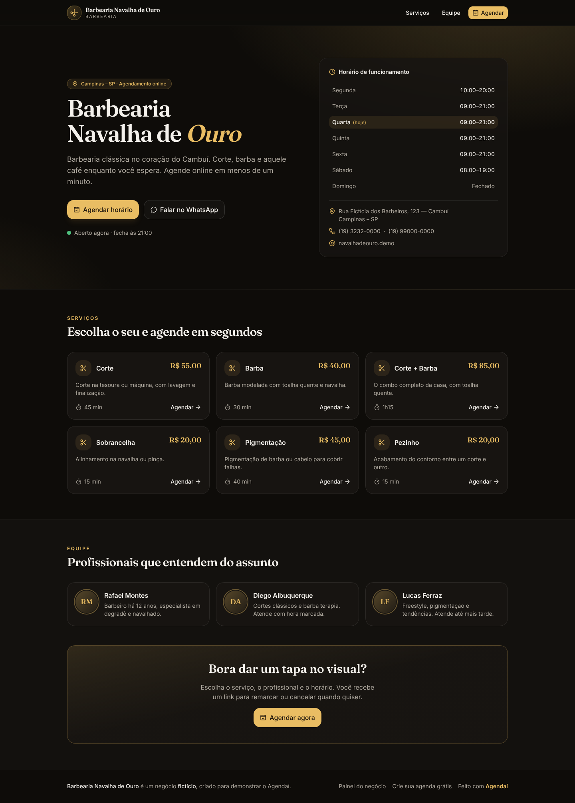
  
</p>

## Sumário
- [Funcionalidades](#funcionalidades)
- [Prints](#prints)
- [Arquitetura](#arquitetura)
- [Stack](#stack)
- [Decisões técnicas](#decisões-técnicas)
- [Rodando localmente](#rodando-localmente)
- [Variáveis de ambiente](#variáveis-de-ambiente)
- [Testes](#testes)
- [Deploy na Vercel + Neon](#deploy-na-vercel--neon)
- [Estrutura do repositório](#estrutura-do-repositório)
- [Limitações conhecidas e próximos passos](#limitações-conhecidas-e-próximos-passos)

## Funcionalidades

### Para o cliente (site público)
- Página do negócio: endereço, horário de funcionamento com "aberto agora", WhatsApp, serviços com preço e duração, equipe.
- Agendamento em 5 etapas com stepper animado: **serviço → profissional (ou "qualquer um") → data e horário → dados → confirmação**.
  - Calendário com dias sem horário desabilitados; horários agrupados em manhã/tarde/noite.
  - WhatsApp com máscara e validação; e-mail opcional.
- Tela de sucesso com **código legível** (ex.: `K7Q-4MZ`), **Adicionar ao Google Agenda**, **Baixar .ics** e link pessoal para gerenciar.
- **Meu agendamento** (link com token secreto): ver, **remarcar** e **cancelar**, respeitando a política de cancelamento.
- Estados de carregamento (skeleton), vazio e erro; mobile-first; respeita "reduzir movimento".

### Para o negócio (painel `/admin`)
- Login com e-mail e senha (cookie httpOnly) e papéis **OWNER** (tudo) e **PROFESSIONAL** (só a própria agenda).
- **Dashboard:** agendamentos de hoje e da semana, faturamento previsto e realizado no mês, taxas de cancelamento e de falta, serviços mais vendidos, gráfico dos últimos 30 dias e próximos agendamentos.
- **Agenda** dia (colunas por profissional, blocos posicionados pelo horário, bloqueios e linha do "agora") e semana.
  Detalhes com ações **confirmar / concluir / faltou / cancelar** e **"Lembrar no WhatsApp"** (mensagem pronta via `wa.me`).
- **Novo agendamento** manual (balcão/telefone).
- **Serviços**, **Profissionais** (editor de expediente com vários intervalos por dia + bloqueios), **Clientes** (busca, histórico, observações) e **Configurações** (dados do negócio, regras de agendamento, feriados).
- Tema claro/escuro; sidebar vira Sheet no celular.

### Regras de negócio (o coração)
- Horários disponíveis consideram: expediente do profissional (inclusive partido), duração do serviço, intervalo entre horários,
  bloqueios (do profissional ou do negócio), agendamentos existentes (exceto cancelados), antecedência mínima,
  limite de dias à frente e horários já passados — tudo no **fuso do negócio**.
- **"Qualquer profissional"**: mostra a união dos horários; ao confirmar, escolhe o livre com **menos agendamentos no dia**.
- **Sem agendamento duplo**, nem com pedidos simultâneos: garantido pelo banco (exclusion constraint) → resposta **409** amigável.
- Mudança de status com regras (não dá para concluir ou marcar falta de um agendamento futuro; cancelado/concluído são finais).

## Prints

| | Celular (375px) | Desktop (1440px) |
| --- | --- | --- |
| Página do negócio |  |  |
| Etapa 1 — serviço |  | 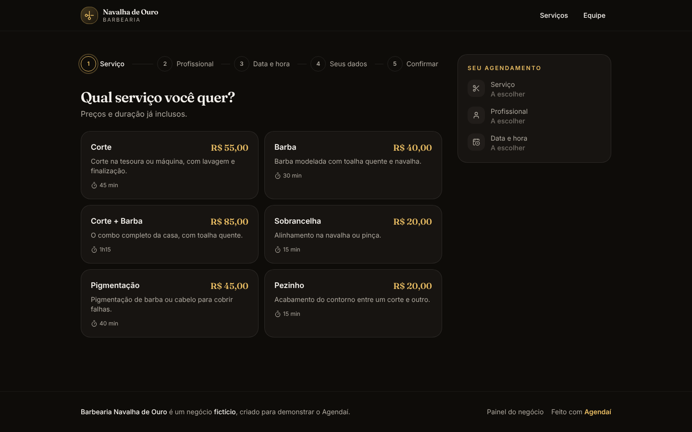 |
| Etapa 2 — profissional |  | 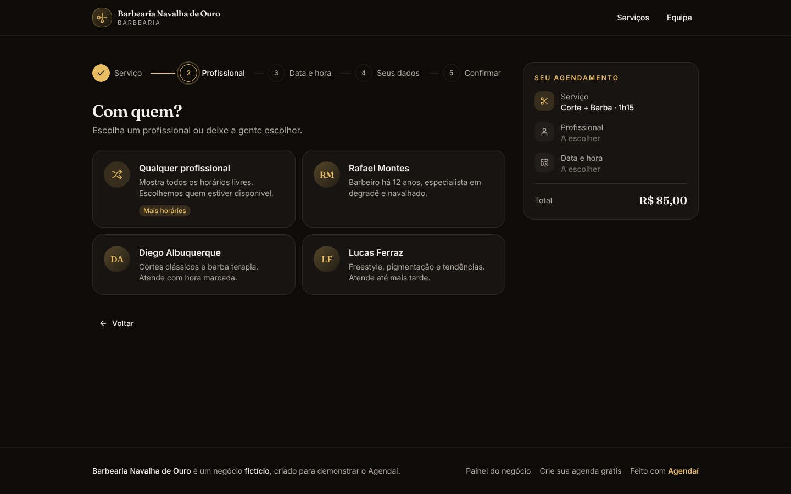 |
| Etapa 3 — data e hora | 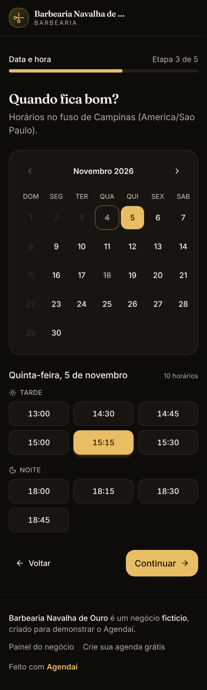 | 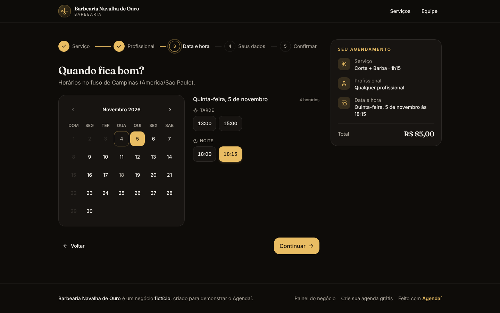 |
| Etapa 4 — dados | 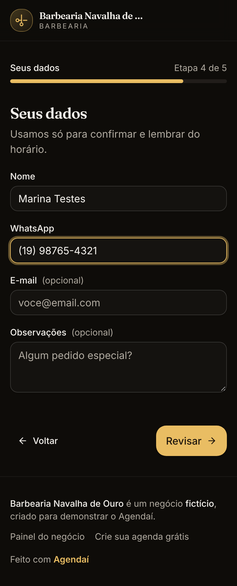 | 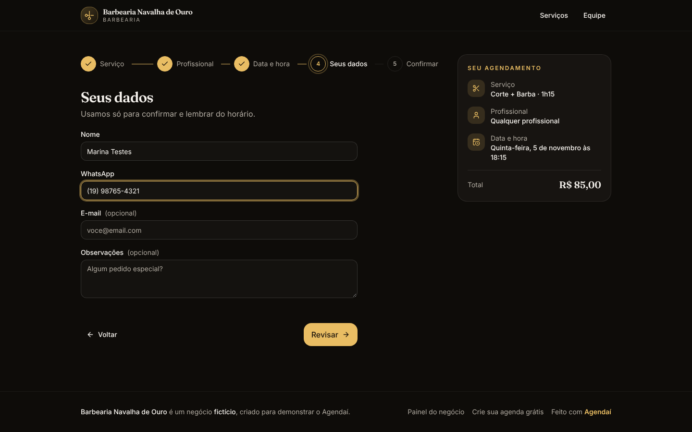 |
| Etapa 5 — confirmação | 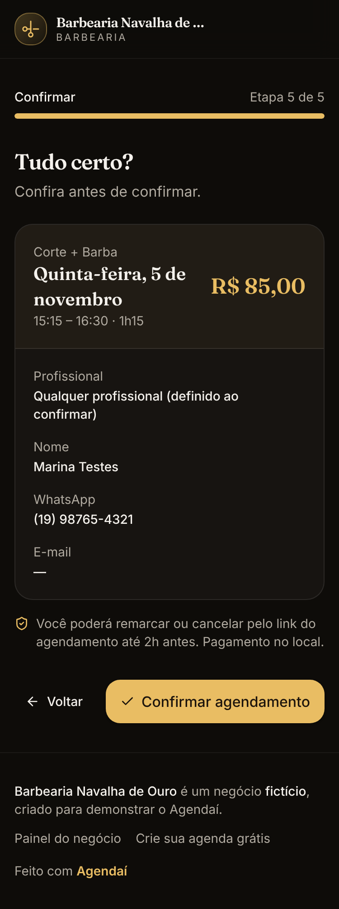 | 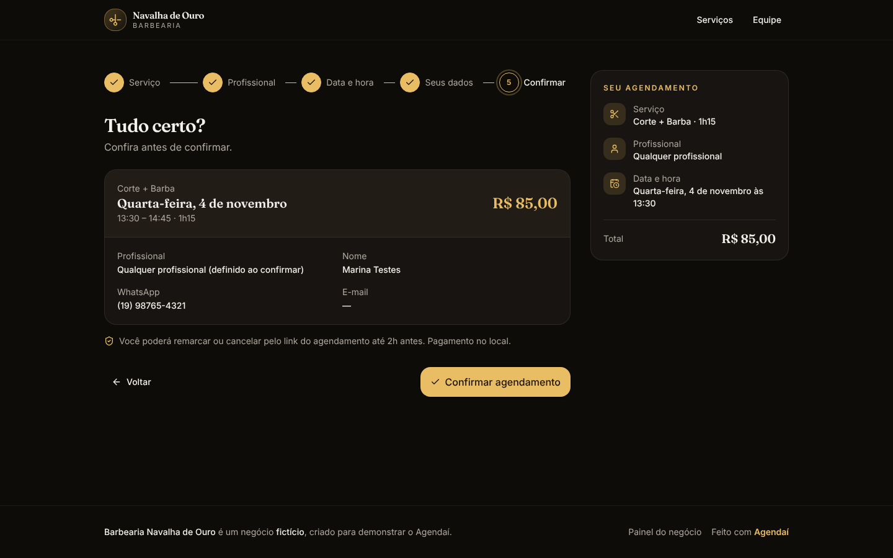 |
| Sucesso | 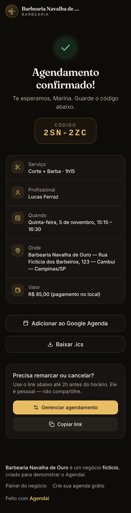 | 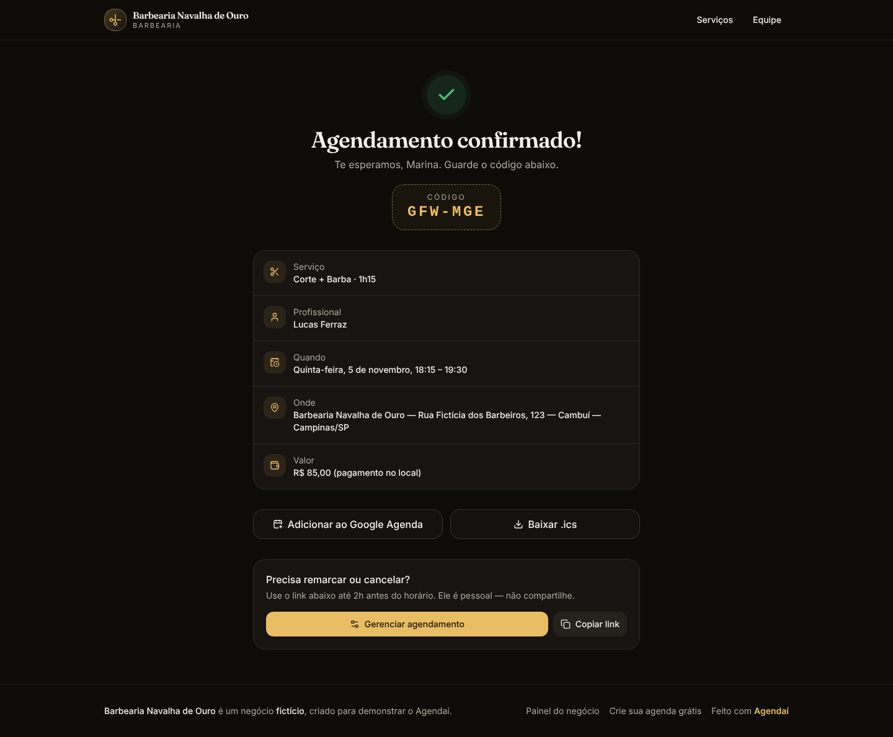 |
| Login do painel | 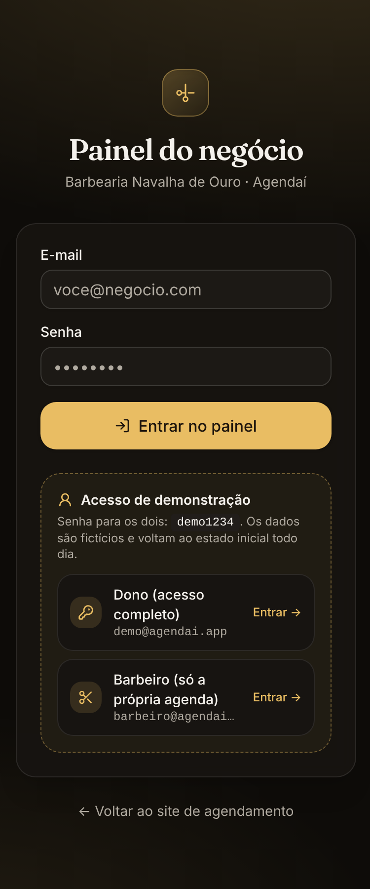 | 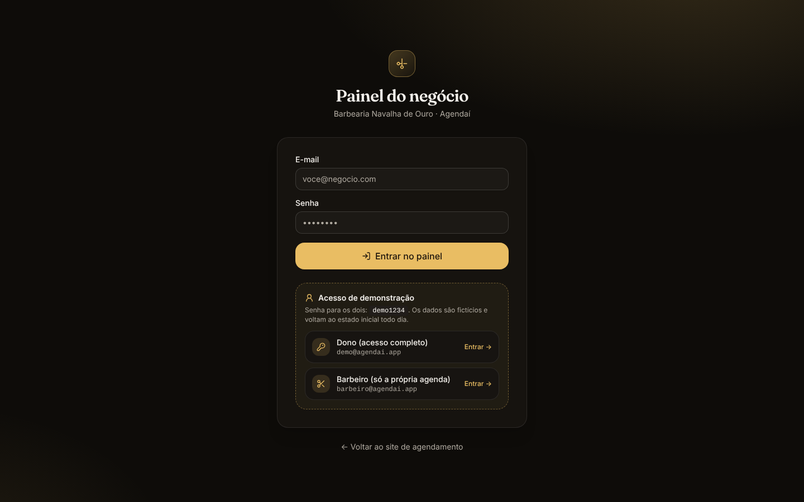 |
| Dashboard | 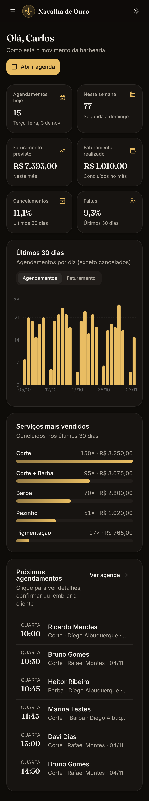 | 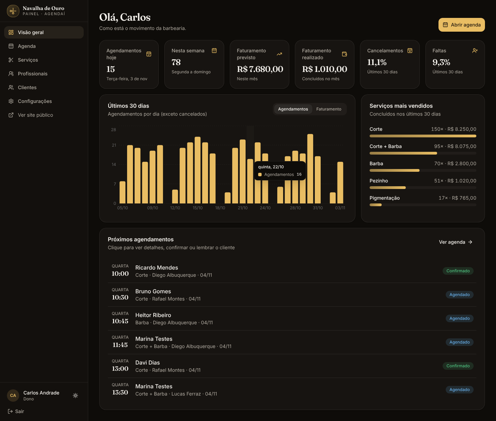 |
| Agenda (dia) | 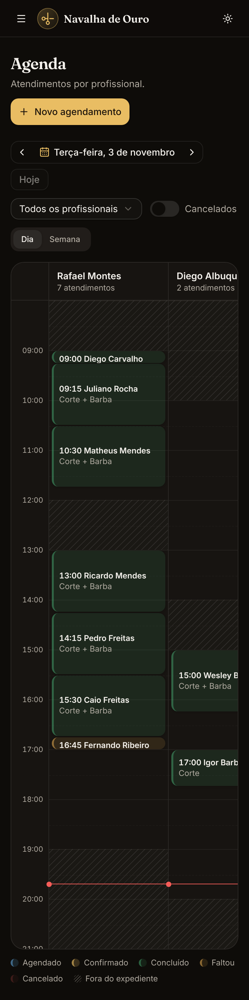 | 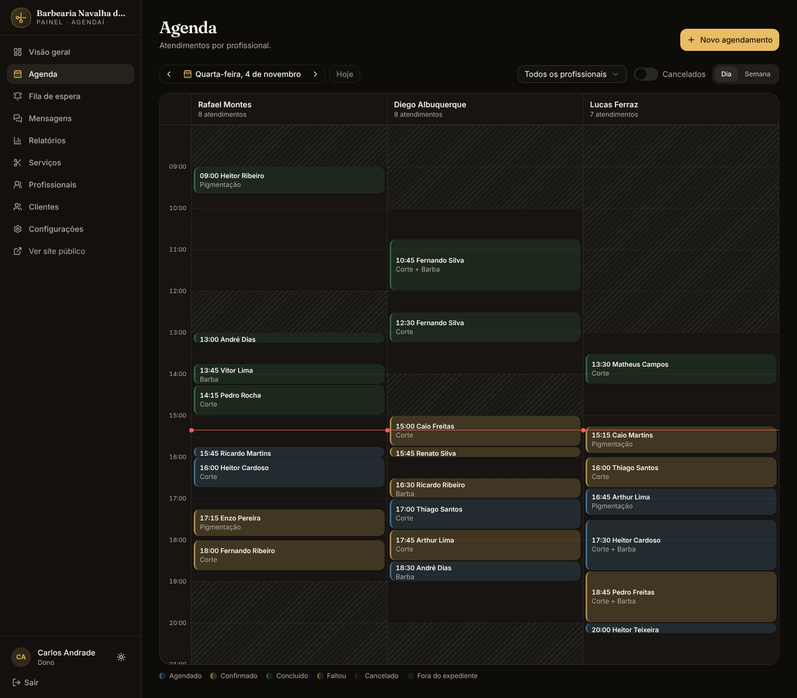 |
| Serviços | 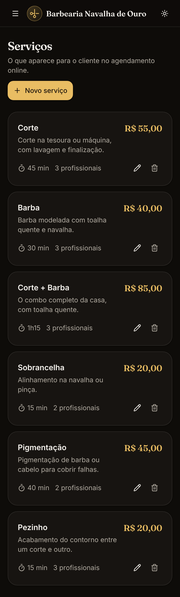 | 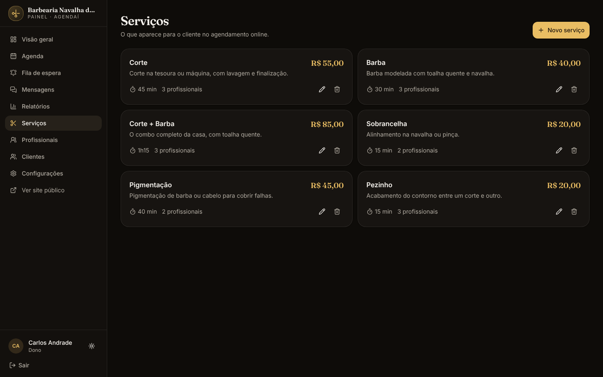 |

Os prints são gerados automaticamente com `npm run screenshots` (veja [Testes](#testes)).

## Arquitetura

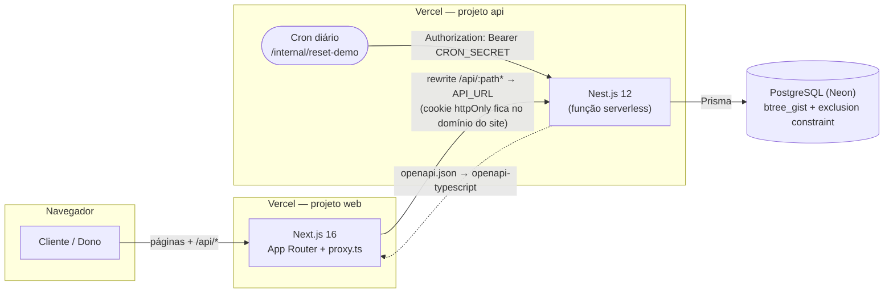

- O navegador **só fala com o Next**. `/api/*` é reescrito para a API, então o cookie de sessão é first-party e não há CORS.
- A API é **stateless** (JWT em cookie httpOnly), pronta para rodar como função serverless.
- O web **não importa código da API**: os tipos vêm do OpenAPI (`npm run gen:api`), e o arquivo gerado é versionado.

## Stack

| Camada | Tecnologias |
| --- | --- |
| API | Nest.js 12 (ESM), Prisma 6, PostgreSQL 16, class-validator, @nestjs/swagger, @nestjs/throttler, JWT (@nestjs/jwt), bcryptjs, date-fns + @date-fns/tz |
| Web | Next.js 16 (App Router), React 19, Tailwind CSS 4, shadcn/ui (Radix), lucide-react, Motion, TanStack Query, react-hook-form + zod, Recharts (Chart do shadcn), sonner, next-themes, openapi-fetch |
| Testes | Vitest (unit + e2e com supertest e Postgres real), puppeteer-core (E2E de navegador e prints) |
| Infra | Vercel (2 projetos + cron), Neon (Postgres), Docker Compose para desenvolvimento |

## Decisões técnicas

- **Exclusion constraint em vez de "checar antes de inserir".** Checar disponibilidade e depois inserir tem condição de corrida:
  dois pedidos simultâneos passam na checagem. A migration cria
  `EXCLUDE USING gist ("professionalId" WITH =, tstzrange("startsAt","endsAt",'[)') WITH &&) WHERE (status <> 'CANCELED')`
  (extensão `btree_gist`). O banco é a fonte da verdade; o serviço traduz a violação (`23P01`) em **409** com mensagem amigável
  e, em "qualquer profissional", tenta o próximo candidato livre. Há um teste e2e que dispara **10 reservas simultâneas** e confirma que só 1 passa.
- **Motor de disponibilidade puro** (`apps/api/src/availability/availability.engine.ts`): recebe expedientes, ocupações, regras e `now`,
  sem banco nem relógio global. Isso torna os casos difíceis (expediente partido, fuso, virada de dia, antecedência) fáceis de testar.
- **UTC no banco, regras no fuso do negócio.** Tudo é `timestamptz`; expedientes são "minutos desde 00:00" locais e convertidos
  com `@date-fns/tz` (`TZDate`). O fuso é um campo do negócio (`America/Sao_Paulo` por padrão).
- **Cookie httpOnly + rewrite no Next.** Evita token em `localStorage` e problemas de cookie entre domínios. `SameSite=Lax`, `Secure` em produção.
  O `proxy.ts` do Next faz só a checagem otimista; quem valida o JWT é a API.
- **Token de gerenciamento + código curto.** O cliente gerencia o agendamento por um token aleatório de 192 bits (link pessoal);
  o código curto (sem caracteres ambíguos) serve para conversa humana.
- **Preço congelado no agendamento** (`priceCents`), para relatórios não mudarem se o preço do serviço mudar.
- **Exclusão "suave"**: serviço/profissional com histórico é desativado em vez de apagado.
- **Tipos do front gerados do OpenAPI** (sem pacote compartilhado): cada app faz deploy sozinho, e o contrato é o Swagger.
- **Swagger com assets por CDN**: em função serverless os arquivos estáticos do `swagger-ui-dist` não são servidos; a rota `/docs` entrega um HTML que carrega CSS/JS do jsDelivr e lê `/openapi.json`.
- **Vitest em vez de Jest**: o Nest 12 é ESM-only e já vem com Vitest (API compatível com Jest: `describe/it/expect`).
- **Prisma 6**: mantém `url`/`directUrl` no `schema.prisma` (exigido pelo projeto e pela Neon com pooler).
- **Componentes shadcn/ui escritos no repositório** (padrão do shadcn: o código é seu). Tema por tokens CSS — trocar a paleta para outro cliente é editar `globals.css`.

## Rodando localmente

Pré-requisitos: **Node 22**, **npm** e **Docker** (ou um PostgreSQL 16 local).

```bash
docker compose up -d
```

```bash
cd apps/api && cp .env.example .env && npm install
```

```bash
npx prisma migrate deploy && npm run db:seed
```

```bash
npm run start:dev
```

API em http://localhost:3001 · Swagger em http://localhost:3001/docs · `GET /health` → `ok`.

Em outro terminal:

```bash
cd apps/web && cp .env.example .env.local && npm install
```

```bash
npm run dev
```

Site em http://localhost:3000 · Painel em http://localhost:3000/admin.

Outros comandos úteis:

| App | Comando | O que faz |
| --- | --- | --- |
| api | `npm run db:seed` | Recria os dados da demo (apaga só o negócio demo) |
| api | `npm run openapi` | Gera `openapi.json` sem precisar de banco |
| web | `npm run gen:api` | Gera `src/lib/api/schema.d.ts` a partir da API rodando (ou de `../api/openapi.json`) |
| web | `npm run screenshots` | Gera os prints em `docs/screenshots` (API + web rodando, `CHROME_PATH`) |
| web | `npm run e2e:browser` | Agenda pelo navegador e confere no painel |

## Variáveis de ambiente

### `apps/api/.env`

| Variável | Obrigatória | Descrição |
| --- | --- | --- |
| `DATABASE_URL` | sim | Postgres. Na Neon, a URL **pooled** (com `-pooler`) |
| `DIRECT_URL` | sim | Postgres sem pooler (usado pelo `prisma migrate`) |
| `JWT_SECRET` | sim (produção) | Segredo do JWT da sessão (`openssl rand -base64 32`) |
| `WEB_ORIGIN` | sim | URL do site (CORS e links do `.ics`) |
| `CRON_SECRET` | sim | Protege `/internal/reset-demo` (a Vercel envia no cron) |
| `PORT` | não | Porta local (padrão 3001) |
| `BUSINESS_SLUG` | não | Negócio servido pelas rotas públicas (padrão `navalha-de-ouro`) |
| `THROTTLE_LIMIT` / `BOOKING_THROTTLE_LIMIT` | não | Limites por minuto por IP (padrão 60 / 10) |
| `TEST_DATABASE_URL` | não | Banco dos testes e2e (padrão `agendai_test` local) |

### `apps/web/.env.local`

| Variável | Obrigatória | Descrição |
| --- | --- | --- |
| `API_URL` | sim | URL da API (padrão `http://localhost:3001`) — usada no rewrite `/api/*` |
| `OPENAPI_URL` | não | Fonte do `npm run gen:api` |
| `CHROME_PATH` / `WEB_URL` | não | Para `npm run screenshots` e `npm run e2e:browser` |

## Testes

```bash
cd apps/api && npm run lint && npm test && npm run test:e2e && npm run build
```

- **Unitários** (`npm test`): motor de disponibilidade (expediente partido, bloqueios, serviço que não cabe no fim do expediente,
  antecedência, limite de dias, fuso horário, virada de dia, "qualquer profissional"), regras de status/política de cancelamento e `.ics`.
- **E2E** (`npm run test:e2e`, Postgres real no banco `agendai_test`, recriado a cada execução):
  fluxo agendar → painel → cancelar pelo link; remarcação; política de cancelamento; permissões OWNER × PROFESSIONAL;
  reset protegido por `CRON_SECRET`; **10 reservas simultâneas do mesmo horário → 1 × 201 e 9 × 409**.

```bash
cd apps/web && npm run lint && npm run build
```

```bash
CHROME_PATH=/usr/bin/google-chrome npm run e2e:browser
```

## Deploy na Vercel + Neon

São **dois projetos na Vercel** apontando para o mesmo repositório (um para `apps/api`, outro para `apps/web`).

1. **Banco (Neon)**
   1. Crie um projeto em [neon.tech](https://neon.tech) (região próxima, ex.: São Paulo).
   2. Em *Connection Details*, copie a URL **pooled** (host com `-pooler`) → `DATABASE_URL`
      e a URL **direta** → `DIRECT_URL`. Mantenha `?sslmode=require`; na pooled acrescente `&pgbouncer=true&connect_timeout=15`.
   3. Não é preciso criar a extensão `btree_gist` manualmente: a migration faz isso.

2. **API (projeto `agendai-api`)**
   1. Vercel → *Add New Project* → importe o repositório → **Root Directory: `apps/api`**.
      O framework **NestJS** é detectado automaticamente (entrypoint `src/app.ts`), sem configurar build.
   2. Variáveis: `DATABASE_URL`, `DIRECT_URL`, `JWT_SECRET`, `CRON_SECRET` e `WEB_ORIGIN` (pode ser provisório; ajuste no passo 4).
   3. Deploy. O script `vercel-build` roda `prisma generate && prisma migrate deploy && nest build` e popula a demo **só se o banco estiver vazio**.
   4. Confira `https://SEU-API.vercel.app/health` (→ `ok`) e `/docs`.
   5. O cron diário de `apps/api/vercel.json` chama `GET /internal/reset-demo`; a Vercel envia `Authorization: Bearer $CRON_SECRET` automaticamente.

3. **Web (projeto `agendai-web`)**
   1. Novo projeto com o mesmo repositório → **Root Directory: `apps/web`** (Next.js detectado).
   2. Variável: `API_URL=https://SEU-API.vercel.app`.
   3. Deploy.

4. **Ligue as pontas:** no projeto da API, defina `WEB_ORIGIN=https://SEU-WEB.vercel.app` e faça *Redeploy*.
   Preencha o link da demo no topo deste README.

> Dica: com domínio próprio, use `agendamento.seudominio.com.br` no web e `api.seudominio.com.br` na API.

## Estrutura do repositório

```
apps/
  api/                    Nest.js (deploy independente)
    prisma/               schema + migrations (inclui a exclusion constraint)
    src/
      availability/       motor de disponibilidade (puro) + serviço
      appointments/       criação, token, status, .ics
      public/  admin/     controladores públicos e do painel
      auth/               login, cookie, guard de papéis
      demo/               dados fictícios, seed e seed-if-empty
      app.ts              entrypoint (convenção da Vercel)
    test/                 e2e (fluxo, permissões, concorrência)
  web/                    Next.js (deploy independente)
    src/app/(public)      site do cliente
    src/app/admin         painel
    src/components/ui     componentes shadcn/ui
    src/lib/api           client tipado + schema gerado do OpenAPI
    scripts/              gen:api, prints e E2E de navegador
docs/
  PROGRESSO.md  screenshots/
docker-compose.yml
```

## Limitações conhecidas e próximos passos

**Limitações**
- Uma instalação atende **um negócio** (as rotas públicas usam `BUSINESS_SLUG`); o modelo de dados já é multi-negócio.
- Lembretes por WhatsApp são **manuais** (link `wa.me`); não há envio automático.
- O rate limit usa memória da instância — em serverless é por instância. Para produção séria, usar Redis/Upstash.
- Agendamento manual respeita expediente e bloqueios (não permite "encaixe" fora do horário).
- Remarcação pelo cliente mantém o mesmo profissional.

**5 melhorias para uma v2**
1. **Lembrete automático por WhatsApp** (API oficial do WhatsApp Business) 24h e 2h antes, com confirmação por resposta.
2. **Pagamento Pix** (sinal ou total) na confirmação, com webhook de baixa e política de no-show.
3. **Multiempresa com subdomínio** (`navalha.agendai.app`), onboarding self-service e planos.
4. **Fila de espera e encaixes**: avisar clientes quando um horário for liberado por cancelamento.
5. **Relatórios e comissões** por profissional, exportação CSV e integração com Google Calendar (sincronização bidirecional).
